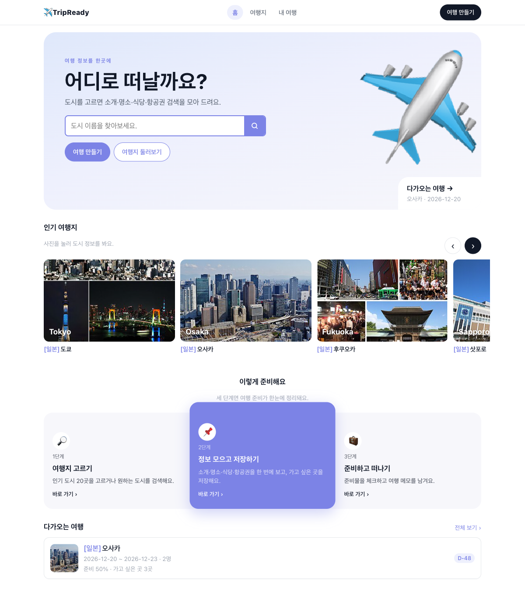
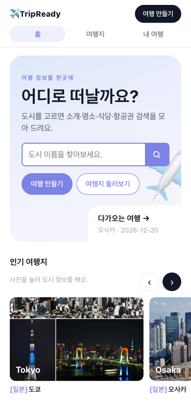
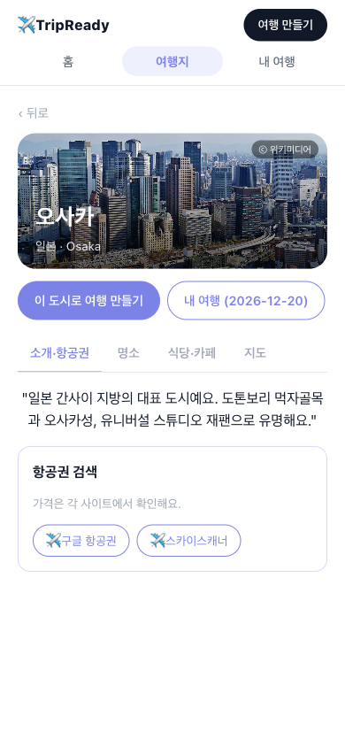
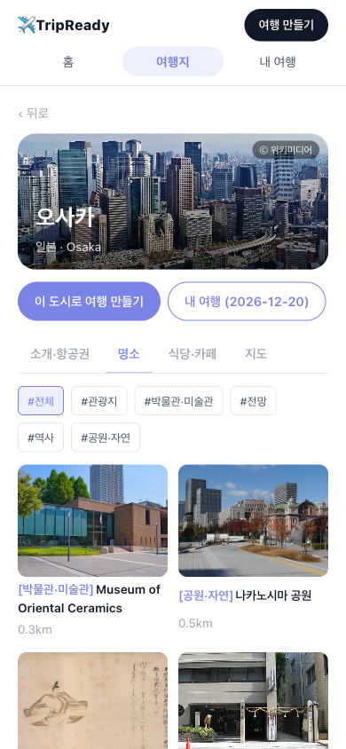
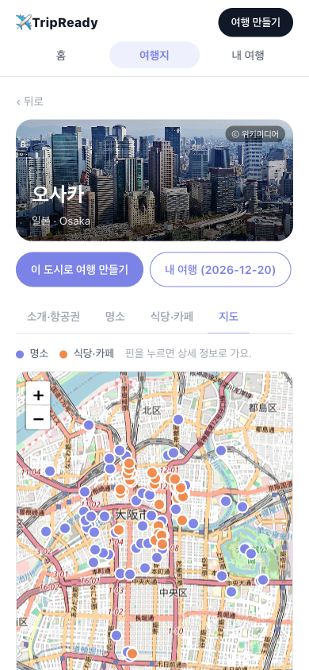
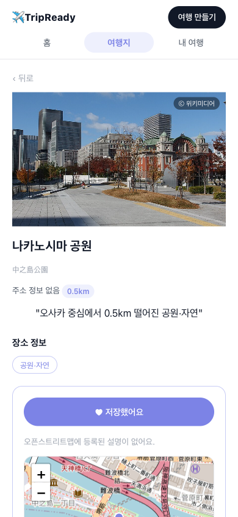
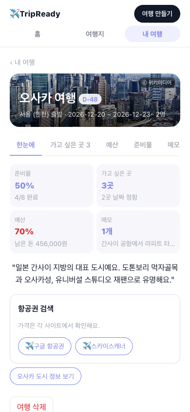
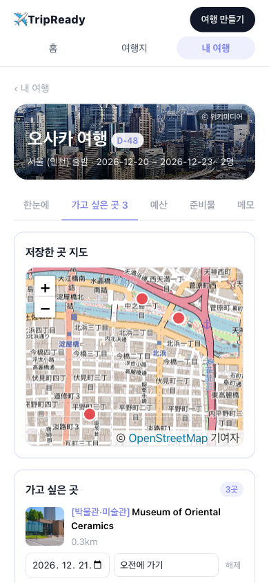
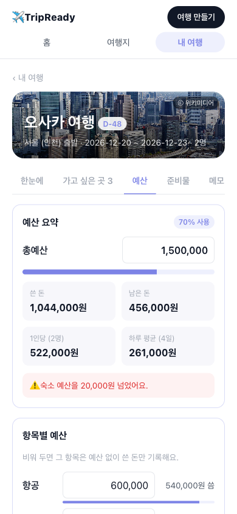

# 여행 준비 (TripReady)

> 도시를 고르면 소개·명소·식당·항공권 검색을 자동으로 모아 보여 주고, 가고 싶은 곳·예산·준비물·메모를 여행별로 기록하는 해외여행 정보 앱

- **배포 링크**: https://hyeeun-hub.github.io/trip-ready/
- **저장소**: https://github.com/hyeeun-hub/trip-ready
- **기술**: React + TypeScript + Vite, localStorage, Vitest, GitHub Pages (GitHub Actions: 테스트 통과 시에만 배포)
- **외부 데이터**: 키가 필요 없는 공개 API만 사용 — 위키백과 REST API, 오픈스트리트맵 Overpass·Nominatim·지도 타일 (지도 그리기: Leaflet)
- **만든 방법**: Claude Code로 바이브 코딩. PRD와 Todo를 먼저 쓰고, Todo 단계마다 커밋하고 단계가 끝날 때마다 push

## 1. 제작한 것 소개

| 기능 | 설명 |
| --- | --- |
| 여행지 고르기 (F1) | 인기 도시 20곳(지역별로 거르기) 또는 도시 이름 검색. 인기 도시의 좌표·공항 코드는 위키백과·위키데이터에서 확인한 값 |
| 여행지 한눈에 보기 (F2) | 도시 소개 2~3줄(인기 20곳은 직접 작성), 위키백과 사진(화면 크기에 맞춘 고화질, ⓒ 출처 링크), 오픈스트리트맵 명소·식당(종류·음식 종류로 거르기), 항공권 검색 링크(구글 항공권·스카이스캐너), 장소 상세, 자동 정보에 출처 표시 |
| 지도 (7단계) | Leaflet + 오픈스트리트맵: 도시 지도 탭(명소·식당 핀, 누르면 상세), 저장한 곳 지도, 장소 상세 작은 지도 |
| 가고 싶은 곳 (F3) | 장소를 여행에 저장하고 방문 예정일(여행 기간 안)·메모를 붙여 모아 보기 |
| 예산 (F4) | 총예산·항목별 예산, 지출 추가·수정·삭제, 남은 돈·1인당·하루 평균, 초과 경고 |
| 내 여행 기록 (F5) | 준비 체크리스트(기본 7개 + 직접 추가, 진행률), 다가오는 여행 / 다녀온 여행 |
| 여행 기록·추억 (F6, 8·10단계) | "1일차 · 점심"처럼 사진 1장과 한 줄 멘트를 남기면 일차별 타임라인, 기록·사진 내보내기/불러오기(사진은 줄여서 브라우저 IndexedDB에 저장). 위쪽 메뉴 "여행 기록"에서 모든 여행을 앨범·타임라인으로 모아 보기 |
| 콜라주 꾸미기 (10단계) | 템플릿 4종(격자·폴라로이드·필름·매거진), 사진 고르기·순서, 제목·부제목, 배경색, 멘트 넣기를 직접 바꾸며 바로 미리 보기, 1080×1350 이미지 저장 |
| 페이지 구성 | 위쪽 메뉴(홈·여행지·내 여행·여행 기록)와 페이지별 탭. 페이지마다 주소가 있어 뒤로 가기·새로고침해도 같은 화면 |

### 스크린숏

예시 데이터(오사카 3박 4일, 2명)로 찍은 화면입니다.

| 홈 (데스크톱) |
| --- |
|  |

| 홈 (모바일) | 도시 · 소개·항공권 | 도시 · 명소 |
| --- | --- | --- |
|  |  |  |

| 도시 · 지도 | 장소 상세 | 여행 · 한눈에 |
| --- | --- | --- |
|  |  |  |

| 여행 · 가고 싶은 곳 (지도) | 여행 · 예산 |
| --- | --- |
|  |  |

### 실행 방법

```bash
npm install
npm run dev      # 개발 서버
npm test         # 단위 테스트 (Vitest)
npm run build    # 타입 검사 + 빌드
```

### 알아 둘 점

- **인기 도시 20곳의 명소·식당은 바로 떠요.** 오픈스트리트맵 공개 서버는 한 번에 25~60초가 걸려서, 인기 도시 데이터는 미리 받아 앱에 넣었습니다(화면에 기준일 표시, `npm run places:update`로 다시 받기). **검색한 도시**는 실시간으로 받아서 처음에 오래 걸릴 수 있고, 도시 화면을 열자마자 미리 불러오기 시작합니다. 한 번 불러온 도시는 하루 동안 저장합니다.
- **식당에는 평점이 없어요.** 키 없이 쓸 수 있는 공개 데이터에 평점·리뷰가 없기 때문입니다. 위키 문서가 있는(널리 알려진) 곳을 먼저, 그다음 도시 중심에서 가까운 순으로 보여 줍니다.
- **항공권 가격은 가져오지 않아요.** 출발·도착·날짜·인원을 채운 검색 사이트 링크로 보냅니다.
- **데이터는 기기마다 따로 저장돼요.** 서버·로그인이 없어서, 해외에서 쓰려면 휴대폰 브라우저에서 여행을 만들어야 합니다.

## 2. 완성 기준 점검 (PRD #10)

| 완성 기준 | 결과 | 근거 |
| --- | --- | --- |
| 인기 도시 20곳 중 하나를 고르거나 도시를 검색해 여행을 만들 수 있다 | 충족 | 도시 데이터 검증 테스트(20곳·필수 값·위키데이터 출처), "교토" 검색 → 교토시로 여행 만들기 브라우저 확인 |
| 여행지 소개·명소·식당·항공권 검색 링크가 한 화면에 보인다 | 충족 (구성 변경) | 사용자 요청으로 한 도시 페이지 안의 탭(소개·항공권 / 명소 / 식당·카페)으로 나눔 |
| 자동 정보마다 출처가 보이고, 실패하면 안내와 다시 시도가 된다 | 충족 | © OpenStreetMap·위키백과(장소 설명) 출처 표시(도시 소개는 7단계에서 직접 쓴 문장으로 바꿔 출처 대상 아님), 연결을 일부러 끊어 "불러오지 못했어요 → 다시 시도" 확인 |
| 명소·식당을 저장하면 여행 화면에서 따로 모아 볼 수 있다 | 충족 | 저장·해제·중복 방지·방문 예정일 테스트, "가고 싶은 곳" 탭 |
| 예산·지출을 기록하면 남은 금액·1인당·하루 평균이 맞고, 초과하면 경고 | 충족 | 예산 계산 테스트(0원, 초과, 1명·여러 명, 당일치기), 브라우저에서 105% 초과 경고 확인 |
| 준비 체크리스트 진행률, 여행 메모 | 충족 | 체크리스트·기록 테스트, 준비물 탭, 메모는 8단계에서 "여행 기록" 탭으로 합쳐짐 |
| 새로고침해도 여행·저장한 곳·예산·체크리스트·메모가 유지된다 | 충족 | 저장·불러오기 테스트, 개발 서버와 배포 링크에서 새로고침 확인 |
| 예산 계산과 데이터 변환 단위 테스트가 모두 통과한다 | 충족 | 테스트 파일 20개, 테스트 116개 통과 (외부 API는 실제 응답을 줄인 고정 응답 사용) |
| GitHub Pages 배포 링크에서 위 기능이 동작한다 | 충족 | 배포 링크에서 여행 만들기 → 둘러보기 → 저장 → 예산 → 준비물 → 메모 → 새로고침 흐름 확인 |

## 3. PRD

<details>
<summary>PRD 전문 펼치기</summary>

### 여행 준비 (TripReady) PRD

#### 1. 한 줄 소개

여행 도시와 날짜를 정하면 그 도시의 소개·명소·식당·항공권 검색을 한 화면에 자동으로 모아 보여 주고, 예산과 준비 과정, 가고 싶은 곳을 여행별로 기록해 두는 해외여행 정보 모아보기 앱.

#### 2. 배경과 문제

- 여행을 준비할 때 항공권 사이트, 지도, 블로그, 위키를 탭 여러 개로 오가며 찾는다.
- 찾은 명소·식당을 여기저기 흩어 저장해서 막상 여행 중에 다시 찾기 어렵다.
- 쓸 돈이 얼마인지, 무엇을 준비했는지 한곳에서 보기 어렵다.

#### 3. 대상 사용자

- 1년에 1~3번 해외여행을 가는 대학생·직장인
- 자유여행을 직접 계획하지만 정보를 정리하는 데 시간이 많이 드는 사람

#### 4. 목표

- 도시만 고르면 여행지 소개·명소·식당·항공권 검색이 **한 화면**에 모인다.
- 마음에 드는 장소를 여행별로 저장해 두고 다시 볼 수 있다.
- 여행마다 **예산**과 **준비 체크리스트**를 함께 관리한다.
- 모든 자동 정보에 **출처**를 표시한다.

#### 5. 핵심 기능

##### F1. 여행 만들기
- 입력: 도시, 출발 도시(기본: 서울), 출국일, 귀국일, 인원
- 도시는 두 가지 방법으로 고른다.
  - **인기 도시 20곳** 버튼에서 바로 고르기: 도쿄, 오사카, 후쿠오카, 삿포로, 오키나와, 타이베이, 홍콩, 싱가포르, 방콕, 치앙마이, 다낭, 나트랑, 하노이, 세부, 발리, 괌, 파리, 런던, 바르셀로나, 뉴욕
  - **도시 검색**: 이름을 입력하고 "검색"을 누르면 오픈스트리트맵 지명 검색(Nominatim)으로 후보를 보여주고, 그중 하나를 고른다.
- 여러 여행을 저장하고 목록에서 고른다.

##### F2. 여행지 한눈에 보기 (자동)
- **여행지 소개**: 위키백과(한국어 우선)에서 도시 요약과 대표 이미지를 가져온다.
- **명소**: 오픈스트리트맵(Overpass API)에서 도시 중심 반경 안의 관광지(`tourism=attraction|museum|viewpoint` 등)를 가져와 목록으로 보여준다.
- **식당**: 오픈스트리트맵에서 식당·카페(`amenity=restaurant|cafe`)를 가져온다. 음식 종류(cuisine)로 거를 수 있다. **평점·리뷰는 없다.**
- **비행기**: 출발 도시·도착 도시·날짜를 채운 항공권 검색 사이트 링크(구글 항공권, 스카이스캐너 등)를 만든다. 가격은 보여주지 않는다.
  - 인기 도시는 미리 넣어 둔 공항 코드로 정확한 공항을 연결한다.
  - 검색으로 고른 도시는 도시 이름으로 항공권 검색을 연다.
- **장소 종류로 거르기**: 야경·박물관·카페·바다·시장·공원 등 종류별로 명소·식당을 거른다.
- **장소 상세**: 사진, 이름, 주소, 도시 중심에서의 거리, 정보 태그(종류·음식 종류·영업시간·웹사이트 등 데이터에 있는 것만), 설명을 보여준다.
- **사진**: 장소에 위키백과·위키미디어 사진 정보가 있으면 그 사진을 출처와 함께 보여주고, 없으면 종류별 기본 그림을 쓴다.
- 각 장소에서 지도(오픈스트리트맵) 링크로 위치를 연다.
- 정보마다 출처(위키백과, © OpenStreetMap 기여자)를 표시한다.
- 불러오기에 실패하면 이유와 "다시 시도" 버튼을 보여준다.

##### F3. 가고 싶은 곳 저장
- 명소·식당을 여행에 저장(즐겨찾기)하고, 메모와 방문 예정일을 붙일 수 있다.
- 저장한 곳은 여행 화면에서 따로 모아 본다.

##### F4. 예산
- 여행마다 총예산을 정하고, 항목(항공, 숙소, 식비, 교통, 관광, 쇼핑, 기타)별 예산을 나눈다.
- 실제 쓴 돈(지출)을 날짜·항목·금액·메모로 기록한다.
- 항목별 예산 대비 지출, 남은 금액, 1인당 금액, 하루 평균을 보여준다. 예산을 넘으면 경고한다.
- 금액은 원화(KRW)로 기록한다.

##### F5. 내 여행 기록 (준비 과정 포함)
- **준비 체크리스트**: 기본 항목(여권 확인, 항공권 예약, 숙소 예약, 여행자 보험, 환전·카드, 유심·eSIM, 짐 싸기)과 직접 추가한 항목을 체크한다. 진행률을 보여준다.
- **여행 메모**: 여행 중·후 한 줄 기록을 날짜별로 남긴다.
- 지난 여행은 "다녀온 여행"으로 모아 본다.

##### F6. 여행 기록과 추억 만들기 (완성 후 사용자 요청으로 추가)
- 여행 중 "N일차 · 점심"처럼 끼니·때를 고르고 사진 1장과 한 줄 멘트를 올리면 기록이 된다. N일차는 출국일 기준으로 자동 계산한다.
- 기록은 일차별 타임라인으로 모아 본다. 저장한 장소를 골라 붙일 수 있다.
- 사진은 올릴 때 긴 변 1280px로 줄여 브라우저 저장소(IndexedDB)에 둔다(서버 없음).
- 기록과 사진을 파일 하나로 내보내고 다시 불러올 수 있다(기기 변경·브라우저 데이터 삭제 대비).
- 여행이 끝나면 올린 사진으로 콜라주 이미지를 만들어 저장한다(전체 또는 하루). 템플릿(격자·폴라로이드·필름·매거진)을 고르고 사진·순서·제목·배경색을 직접 바꿀 수 있다.
- 위쪽 메뉴 "여행 기록"에서 모든 여행의 기록을 앨범·타임라인으로 모아 본다.

#### 6. 만들지 않는 것

- 항공권·숙소 실시간 가격 조회와 예약
- 평점·리뷰 기반 맛집 순위 (키 없이 가져올 수 있는 공개 데이터에 없음)
- 동선 최적화, 자동 일정 짜기
- 비자·입국 요건 같은 국가 규정 안내 (출처 확인 부담이 커서 이번 범위에서 제외)
- 로그인, 서버, 여러 기기 동기화
- 기록 사진으로 영상(릴스) 만들기와 배경 음악 → 향후 과제 (MP4 변환·음악 저작권 확인 필요)

#### 7. 기술 조건

- React + TypeScript + Vite
- 저장: localStorage (서버 없음)
- 테스트: Vitest (예산 계산, 데이터 변환, 저장 로직 단위 테스트. 외부 API는 고정 응답으로 테스트)
- 배포: GitHub Pages
- **외부 API 키 없이 동작**: 위키백과 REST API, 오픈스트리트맵 Overpass API, 오픈스트리트맵 Nominatim(도시 검색)만 사용
- 인기 도시 20곳의 명소·식당은 미리 받아 둔 오픈스트리트맵 데이터를 앱에 넣어 바로 보여준다(기준일 표시, `npm run places:update`로 다시 받음). 검색 도시는 실시간으로 받는다.
- 각 API의 이용 정책을 지킨다: 요청 횟수 제한(Nominatim은 1초에 1번, 입력 중 자동완성 금지 → "검색" 버튼으로만 요청), 응답 캐시(같은 도시는 하루 동안 다시 요청하지 않음), 출처 표시

#### 8. 데이터 원칙

- 자동으로 가져온 정보에는 출처를 함께 표시한다.
- 앱이 직접 사실(영업시간, 가격 등)을 지어내지 않는다. 데이터에 없는 값은 비워 둔다.
- 오픈스트리트맵 데이터는 지역마다 빠진 곳이 있을 수 있다고 안내한다.
- 인기 도시 20곳의 기본 데이터(위키 문서명, 좌표, 공항 코드)는 기억으로 쓰지 않고 위키백과·위키데이터에서 확인한 값만 넣고, 확인한 출처 URL을 함께 둔다.

#### 9. 가정과 열린 질문

- 가정: 출발 도시는 서울(인천)을 기본으로 한다.
- 가정: 검색으로 고른 작은 도시는 위키·명소·식당 정보가 적거나 없을 수 있다. 이때는 "정보가 적어요" 안내를 보여준다.
- 열린 질문: 지도 화면을 직접 그릴지(라이브러리 Leaflet 추가 필요, 동의 필요), 지도 링크로만 연결할지.
- 열린 질문: 환율 자동 변환을 넣을지 (키 없는 환율 API 확인 필요).

#### 10. 완성 기준

- [x] 인기 도시 20곳 중 하나를 고르거나 도시를 검색해 여행을 만들 수 있다.
- [x] 도시와 날짜로 여행을 만들면 여행지 소개·명소·식당·항공권 검색 링크가 한 화면에 보인다.
  - 점검 메모: 페이지 구성 변경(사용자 요청)으로 한 도시 페이지 안의 탭(소개·항공권 / 명소 / 식당·카페)으로 나눠 보여준다. 여행 화면에서는 한눈에·둘러보기 탭.
- [x] 자동 정보마다 출처가 보이고, 불러오기에 실패하면 안내와 다시 시도가 된다.
- [x] 명소·식당을 저장하면 여행 화면에서 따로 모아 볼 수 있다.
- [x] 예산을 항목별로 정하고 지출을 기록하면 남은 금액·1인당·하루 평균이 맞게 계산되고, 초과하면 경고가 뜬다.
- [x] 준비 체크리스트를 체크하면 진행률이 바뀌고, 여행 메모를 남길 수 있다.
- [x] 새로고침해도 여행·저장한 곳·예산·체크리스트·메모가 유지된다.
- [x] 예산 계산과 데이터 변환 단위 테스트가 모두 통과한다.
- [x] GitHub Pages 배포 링크에서 위 기능이 동작한다.

</details>

## 4. Todo 리스트

진행 결과는 [TODO.md](TODO.md)에 있습니다. 모든 항목은 "구현 → 테스트 통과 → 브라우저 확인 → 체크" 순서로 완료 처리했습니다.

<details>
<summary>Todo 전문 펼치기 (체크 상태 포함)</summary>

### 여행 준비 (TripReady) Todo

하루 완성을 목표로 단계마다 **커밋**, 단계가 끝날 때마다 **push** 한다.
항목 형식: `단계-순번. [우선순위] 내용 (PRD 근거)`
완료 절차: 구현 → 테스트 통과 → 브라우저에서 직접 확인 → 체크 → (계획과 달라졌으면) 변경 내역 기록 → 커밋

---

#### 0단계. 준비
- [x] 0-1. [P1] Vite + React + TypeScript 프로젝트 세팅, GitHub Public 저장소 연결 (PRD #7)
- [x] 0-2. [P1] Vitest 설정, 샘플 테스트 1개 통과 (PRD #7)
- [x] 0-3. [P1] PRD.md, TODO.md, CLAUDE.md(작업 규칙) 커밋 (PRD 전체)
- [x] 0-4. [P2] 프로젝트 스킬 작성: Todo 마무리 스킬, 외부 데이터 연동 점검 스킬 (과제 요건)
- [x] 0-5. [P1] GitHub Pages 배포 설정, 빈 화면이 배포 링크에서 열리는지 확인 (PRD #7)
- 커밋 후 **push**

#### 1단계. 여행 만들기와 기록
- [x] 1-1. [P1] 데이터 타입 정의: 여행, 도시(이름·국가·좌표·위키 문서명·공항 코드·출처) (F1)
- [x] 1-2. [P1] 인기 도시 20곳 데이터: 위키백과·위키데이터에서 확인한 값만 입력 (F1, PRD #8)
- [x] 1-3. [P1] 여행 만들기(인기 도시 선택, 지역별 거르기), 여행 목록(다가오는 여행 / 다녀온 여행) (F1, F5)
- [x] 1-4. [P1] localStorage 저장·불러오기 (PRD #10)
- [x] 1-5. [P1] 준비 체크리스트: 기본 항목 + 직접 추가, 진행률 (F5)
- [x] 1-6. [P2] 여행 메모: 날짜별 한 줄 기록 (F5)
- [x] 1-7. [테스트] 저장·불러오기, 체크리스트 진행률, 인기 도시 데이터 검증(20곳·필수 값·출처) 단위 테스트, 새로고침 후 유지 확인
- 커밋 후 **push**

#### 2단계. 여행지 정보 자동 모아보기
- [x] 2-1. [P1] 도시 검색(Nominatim): "검색" 버튼으로만 요청, 후보 목록에서 선택, 1초 1회 제한 (F1, PRD #7)
- [x] 2-2. [P1] 위키백과 요약 불러오기(한국어 우선, 없으면 영어), 출처 표시 (F2)
- [x] 2-3. [P1] 오픈스트리트맵 명소 불러오기(Overpass), 이름·종류·지도 링크 (F2)
- [x] 2-4. [P1] 오픈스트리트맵 식당 불러오기, 음식 종류 필터 (F2)
- [x] 2-5. [P1] 항공권 검색 링크 만들기: 인기 도시는 공항 코드, 검색 도시는 도시 이름 (F2)
- [x] 2-6. [P1] 불러오는 중 / 실패 / 다시 시도 화면, 같은 도시 응답 하루 캐시 (F2, PRD #7)
- [x] 2-7. [P1] 장소 종류로 거르기, 장소 상세(사진·주소·도시 중심에서 거리·정보 태그·설명), 위키미디어 사진 또는 기본 그림 (F2)
- [x] 2-8. [테스트] API 응답 → 화면용 데이터 변환 테스트 (고정 응답 사용), 링크 생성 테스트, 검색 요청 간격 테스트
- [x] 2-9. [테스트] 브라우저에서 인기 도시 20곳 불러오기 확인, 검색 도시 2곳 이상(큰 도시·작은 도시) 확인
- 커밋 후 **push**

#### 3단계. 가고 싶은 곳 저장
- [x] 3-1. [P1] 명소·식당 저장/해제, 메모·방문 예정일 (F3)
- [x] 3-2. [P1] 여행 화면에 "저장한 곳" 모아보기 (F3)
- [x] 3-3. [테스트] 저장·해제·중복 저장 방지 테스트, 새로고침 후 유지 확인
- 커밋 후 **push**

#### 4단계. 예산
- [x] 4-1. [P1] 총예산과 항목별 예산 설정 (F4)
- [x] 4-2. [P1] 지출 기록: 날짜·항목·금액·메모, 수정·삭제 (F4)
- [x] 4-3. [P1] 요약: 항목별 예산 대비 지출, 남은 금액, 1인당, 하루 평균, 초과 경고 (F4)
- [x] 4-4. [테스트] 예산 계산 단위 테스트 (0원, 초과, 인원 1명/여러 명, 당일치기)
- 커밋 후 **push**

#### 5단계. 다듬기와 전체 확인
- [x] 5-1. [P2] 빈 상태(여행 없음, 저장한 곳 없음, 지출 없음) 안내 화면 (전체)
- [x] 5-2. [P2] 모바일 너비(390px)에서 깨짐 없이 동작 (전체)
- [x] 5-3. [테스트] 전체 흐름 브라우저 확인: 여행 만들기 → 여행지 정보 → 장소 저장 → 예산·지출 → 체크리스트·메모
- [x] 5-4. [테스트] 배포 링크에서 같은 흐름 확인
- 커밋 후 **push**

#### 6단계. 완성 기준 점검과 README
- [x] 6-1. [P1] PRD #10 완성 기준 하나씩 점검, 결과 기록
- [x] 6-2. [P1] README 작성: 소개, PRD·Todo, Todo 변경 내역, 스킬(SKILL.md 전문 + 사용 사례), 느낀 점·결론
- [x] 6-3. [P1] 스크린숏 추가
- 커밋 후 **push**

#### 7단계. 추가 기능 (사용자 요청)
- [x] 7-1. [P1] 인기 도시 20곳 소개를 2~3줄(어느 지역인지, 무엇이 유명한지)로 직접 작성, 위키백과 문장·출처 표시 제거 (F2)
- [x] 7-2. [P1] 지도: Leaflet + 오픈스트리트맵 타일, 도시 화면 지도 탭(명소·식당 핀), 저장한 곳 지도, 장소 상세 작은 지도 (F2, F3)
- [x] 7-3. [P2] 도시 사진 고화질 (사용자가 비교 예시를 보고 방식 결정)
- [x] 7-4. [테스트] 지도·소개 단위 테스트, 데스크톱·모바일 브라우저 확인
- 커밋 후 **push**

---

#### 8단계. 여행 기록과 추억 만들기 (사용자 요청)
- [x] 8-1. [P1] 여행 기록: N일차 자동 계산, 끼니·때(아침·점심·저녁·간식/카페·기타), 사진 1장과 한 줄 멘트, 저장한 장소 붙이기, 일차별 타임라인 (F6)
- [x] 8-2. [P1] 사진 저장: 긴 변 1280px로 줄여 IndexedDB에 저장, 기록·사진 내보내기/불러오기, 여행 삭제 시 사진도 삭제 (F6)
- [x] 8-3. [P1] 콜라주: 사진 1~9장 격자 배치 + 여행 이름·날짜, 전체 또는 하루 선택, 이미지 저장 (F6)
- [x] 8-4. [테스트] 일차 계산·기록·콜라주 배치·사진 크기·내보내기 단위 테스트, 실제 사진으로 브라우저 확인
- 커밋 후 **push**

#### 9단계. 장소 불러오기 속도 (사용자 요청)
- [ ] 9-1. [P1] 인기 도시 20곳 명소·식당을 미리 받아 앱에 넣기(`npm run places:update`), 기준일 표시, 새로고침한 장소 주소도 찾기 (F2)
- [ ] 9-2. [P1] 검색 도시: 도시 화면을 열자마자 명소·식당 미리 불러오기, 같은 요청은 한 번만 보내기 (F2)
- [ ] 9-3. [테스트] 미리 받은 데이터 형식 검사, 불러오기 테스트, 브라우저에서 걸리는 시간 확인
- 커밋 후 **push**

#### 10단계. 여행 기록 모아 보기와 콜라주 꾸미기 (사용자 요청)
- [x] 10-1. [P1] 위쪽 메뉴 "여행 기록" 페이지: 모든 여행의 기록을 앨범(사진)·타임라인으로, 여행별로 거르기 (F6)
- [x] 10-2. [P1] 콜라주 꾸미기: 템플릿 4종(격자·폴라로이드·필름·매거진), 사진 고르기·순서, 제목·부제목, 배경색, 멘트 넣기, 바로 미리 보기, 1080×1350 저장 (F6)
- [x] 10-3. [P2] 여행 "한눈에" 카드 4개를 넓은 화면에서 한 줄로 (F5)
- [x] 10-4. [테스트] 템플릿 배치(장수·캔버스 안), 사진 고르기, 여러 여행 모아 보기 테스트, 데스크톱·모바일 브라우저 확인
- 커밋 후 **push**

#### 하지 않기로 한 것 (향후 과제)
- 평점 있는 맛집 (구글 Places 등 키가 필요한 API + 서버)
- 항공권 실시간 가격
- 환율 자동 변환
- 기록 사진으로 영상(릴스) 만들기, 배경 음악 넣기 (MP4 변환 라이브러리가 크고, 음악은 저작권 확인이 필요)
- 앱처럼 쓰기(PWA): 홈 화면 추가, 인터넷 없이 저장한 여행·장소 보기 — 웹을 먼저 완성하고 필요하면 추가

</details>

## 5. Todo 리스트 변경 내역

처음 계획과 달라진 점을 그때그때 기록했습니다. 모두 49건이며, 추가 12건, 변경 17건, 삭제 0건, 테스트·브라우저 확인 결과로 바뀐 것 20건입니다.

| 번호 | 구분 | 처음 계획 → 바뀐 내용 | 이유 |
| --- | --- | --- | --- |
| 0-1 | `[변경]` | Vite 기본 구성 → tsconfig 1개, public 폴더 없이(파비콘은 index.html에 직접) | 첫 버전에서 루트 파일이 너무 많다는 의견을 반영 |
| 0-3 | `[변경]` | CLAUDE.md를 루트 → `.claude/CLAUDE.md`에 둠, 화면 참고 메모(`.claude/design-notes.md`) 추가 | 루트를 깔끔하게 유지하고, 디자인은 Todo 대신 구현 참고로 두기로 함 |
| 0-5 | `[변경]` | Pages 배포 → GitHub Actions로, 테스트 통과 시에만 배포 | 추가 라이브러리 없이 push만으로 배포하고, 테스트 실패 코드는 배포하지 않기 위해 |
| 1-2 | `[변경]` | 공항 코드 → 공항 이름으로 위키데이터에서 찾아 IATA 확인, 도시와 60km 안인지 검사 | "취항 도시" 검색으로는 나리타·타오위안·세부·발리 공항이 빠짐 |
| 1-2 | `[테스트]` | 나라 → 위키데이터의 현재 값만 사용 | 런던이 "대영제국", 바르셀로나가 "로마 제국"으로 나옴 |
| 1-2 | `[변경]` | 파리 문서 "파리" → "파리 (프랑스)", 나트랑 나라는 위키데이터 설명으로 보충 | 동음이의 문서라 좌표가 없었고, 나트랑 항목에는 나라 값이 없었음 |
| 1-3 | `[테스트]` | 지역 칩 7개 → 5개(일본·중화권·동남아·유럽·미국) | 390px에서 "홍콩·싱가포르" 칩이 두 줄로 깨짐 |
| 1-3 | `[추가]` | 출발 공항 4곳(인천·김포·김해·제주) 선택, 코드는 위키데이터로 확인 | PRD의 "출발 도시(기본: 서울)"를 고를 수 있게 |
| 1-3 | `[변경]` | 첫 화면 검색창 → 지금은 인기 도시 이름 거르기, 실제 도시 검색은 2-1에서 | 도시 검색(Nominatim)은 2단계 항목 |
| 2-1 | `[테스트]` | 도시 검색 → 한글 검색이 비면 "시"를 붙여 한 번 더 검색, 범위는 정착지(settlement) | "교토"·"가오슝"은 결과 0개, "교토시"·"가오슝시"는 찾음 (실제 API 확인) |
| 2-3 | `[테스트]` | Overpass 서버 1곳 → 서버 3곳 차례로 시도, 서버당 60초까지 기다림, "1분 가까이 걸릴 수 있어요" 안내 | 기본 서버가 502를 내거나 응답에 24~51초가 걸림 |
| 2-3 | `[변경]` | 장소 이름 → 한국어, 없으면 영어, 없으면 현지 이름(현지 이름은 함께 표시) | 방콕 실제 데이터 대부분이 태국어 이름만 있었음 |
| 2-2 | `[테스트]` | 도시 사진 → 한국어 문서에 사진이 없으면 영어 문서 사진 사용 | 나트랑(나짱) 한국어 문서에만 사진이 없었음 |
| 2-4 | `[테스트]` | 음식 종류 값을 소문자로 맞춤 | 도쿄 식당 칩에 "Soba"와 "soba"가 따로 나옴 |
| 2-7 | `[테스트]` | 도시 화면 큰 사진이 안 보임 → 사진 영역을 블록으로 고침 | 브라우저에서 도시 화면 맨 위 사진 높이가 0이었음 |
| 2-3 | `[테스트]` | 넓은 여행지 → 명소는 위키데이터 있는 곳만, 식당은 중심 3km, 서버는 응답한 2곳만 | 발리(반경 15km) 질의가 모든 서버에서 117초 뒤 504로 실패 |
| 1-2 | `[테스트]` | 발리 장소 검색 중심 → 섬 중앙 좌표 대신 덴파사르(위키데이터) 좌표, 반경 5km | 섬 중앙이 산지라 식당 0곳, 명소 3곳뿐이었음 |
| 2-5 | `[테스트]` | 항공권 링크 형식 확정 | 구글 항공권·스카이스캐너 링크를 실제로 열어 출발·도착·날짜·인원이 채워지는 것을 확인 |
| 2-9 | `[변경]` | 인기 도시 20곳 모두 불러오기 → 위키 소개·사진은 20곳 모두, 오픈스트리트맵은 6곳(도쿄·후쿠오카·발리·괌·호이안 등)만 확인 | 장소 질의 한 번에 25~60초가 걸려 40번(20곳×명소·식당) 호출은 공개 서버에 부담이 큼 |
| 3-1 | `[추가]` | 방문 예정일은 여행 기간 안만 허용, 여행이 없는 도시는 "여행을 만들면 저장할 수 있어요" 안내 | 여행 기간 밖 날짜를 넣으면 일정이 의미 없어지고, 여행 없이 상세에 들어가면 저장 버튼이 할 일이 없음 |
| 3-1 | `[변경]` | 장소 정보 → 저장할 때의 값을 그대로 보관 | 오픈스트리트맵 캐시가 하루 지나 사라져도 저장한 곳은 보여야 함 |
| 3-2 | `[테스트]` | 도시 화면의 여행 만들기 폼 → 장소 목록 위로 이동 | 브라우저에서 폼이 장소 60곳 아래에 있어 끝까지 내려야 했음 |
| 향후 | `[추가]` | 없음 → PWA(홈 화면 추가·오프라인 보기)를 향후 과제로 둠 | 해외에서 쓸 때를 검토한 결과, 웹을 먼저 완성하고 필요하면 추가하기로 함 |
| 1-3, 2-7, 3-2 | `[변경]` | 한 페이지 스크롤 → 위쪽 메뉴(홈·여행지·내 여행)와 페이지별 탭으로 나눈 구성, 페이지마다 주소(뒤로 가기·새로고침 유지) | 기능이 늘면서 한 화면 스크롤이 너무 길어짐 (사용자 요청) |
| 4-4 | `[테스트]` | 날짜 검사(1단계 isISODate) → 없는 달("2026-13-01")도 오류 없이 false | 지출 검사 테스트에서 없는 달을 넣자 날짜 함수가 오류로 멈춤 |
| 4-1 | `[추가]` | 항목별 예산 합이 총예산보다 많으면 경고, 금액에 쉼표 허용 | 항목 예산을 나누다 보면 합이 총예산을 넘기 쉽고, "1,000,000"처럼 쓰는 경우가 많음 |
| 4-2 | `[변경]` | 지출 날짜 → 여행 기간 밖도 허용 | 항공권·숙소는 출국 전에 결제하는 경우가 많음 |
| 4-3 | `[테스트]` | 잘못된 금액에 "숫자만 입력해요" 안내, 지출 메모 두 줄까지 표시 | 브라우저에서 "50만"을 넣으면 빨간 테두리만 보이고, 메모가 한 글자만 보였음 |
| 4-2, 4-3 | `[테스트]` | 금액 칸에 쉼표 표시(1,500,000), 휴대폰에서 지출 한 건을 두 줄(날짜·금액 / 항목·메모)로 표시 | 예시 화면을 찍어 보니 "1500000"이 읽기 어렵고, 메모가 좁은 칸에서 "유니버 설 스튜디오…"처럼 잘렸음 |
| 5-1 | `[변경]` | 빈 상태 화면 새로 만들기 → 페이지 구성 변경 때 넣은 안내(여행 없음·저장한 곳 없음·지출 없음·메모 없음)를 점검하고, 없는 주소용 "찾을 수 없어요" 안내 확인 | 페이지를 나누면서 빈 상태 안내가 이미 들어가 있었음 |
| 5-3 | `[테스트]` | 금액 칸 → Enter를 눌러도 저장 | 전체 흐름 확인 중 금액 칸은 칸을 벗어나야만 저장된다는 것을 확인 |
| 4-4 | `[테스트]` | 금액 형식(Intl.NumberFormat)을 테스트마다 만들기 → 모듈에서 한 번만 만듦 | GitHub Actions에서 금액 테스트가 5초 시간 초과로 실패해 배포가 막힘 (로컬에서는 통과) |
| 6-1 | `[테스트]` | 완성 기준 "한 화면에 보인다" → 충족으로 보되 "한 도시 페이지 안의 탭"이라고 점검 메모를 붙임 | 페이지 구성 변경으로 소개·명소·식당이 탭으로 나뉘어 문구 그대로는 맞지 않았음 |
| 6-3 | `[변경]` | 스크린숏 → Playwright 도구로 예시 데이터(오사카 3박 4일)를 넣고 7장을 `docs/screenshots/`에 저장 | 앱 내장 브라우저 스크린숏은 파일로 저장되지 않아 README에 넣을 수 없었음 |
| 7-1 | `[추가]` | 도시 소개 → 인기 20곳은 직접 쓴 2~3줄, 위키백과 문장과 출처 표시는 뺌 | 사용자 요청: 소개를 짧게(지역·유명한 것), 위키백과 출처 문구 제거. 위키백과 문장은 출처 표시가 라이선스 조건이라 문장 자체를 쓰지 않기로 함 |
| 7-2 | `[추가]` | 하지 않기로 한 "지도 화면 직접 그리기" → Leaflet으로 추가 | 사용자 요청, Leaflet 추가 동의 받음 |
| 7-3 | `[추가]` | 도시 사진 330px 썸네일 → 고화질 | 사용자가 사진 화질이 낮다고 함. 지금 사진·같은 사진 고화질·위키보이지 배너 비교 예시를 보여 주고 결정을 기다림 |
| 7-3 | `[변경]` | 고화질 방식 → 비교 예시 중 "② 같은 사진 고화질" 선택: 위치별로 500·960·1280px, 원본이 더 작으면 원본 | 사용자가 ①지금·②같은 사진 고화질·③위키보이지 배너 비교를 보고 결정(배너는 어둡거나 잘린 사진이 있었음) |
| 7-3 | `[추가]` | 큰 사진에 "ⓒ 위키미디어" 출처 링크, 화면 아래 사진·지도 출처 줄 | 고화질 사진도 위키미디어 공용 라이선스상 출처 표시가 필요함 |
| 7-4 | `[테스트]` | 도시 지도 → 명소·식당 중 하나만 실패하면 나머지만 보여주고 "다시 시도" 안내 | 스크린숏을 다시 찍는 중 공개 서버가 502·504를 내 식당 목록만 실패했는데 지도 전체가 오류로 바뀜 |
| 6-3 | `[변경]` | 스크린숏 7장 → 7단계 반영해 9장(도시 소개·지도 추가)으로 다시 찍음 | 고화질 사진·짧은 소개·지도가 들어가 예전 스크린숏이 실제 화면과 달라짐 |
| 8-1~8-4 | `[추가]` | 없음 → 여행 기록(사진·멘트·일차 타임라인)과 콜라주 | 사용자 요청: 여행 중 사진과 한 줄을 남기고, 끝나면 사진으로 꾸며 주는 기능 |
| 향후 | `[추가]` | 기록 영상(릴스)·배경 음악 → 향후 과제 | 크롬은 WebM만 만들어 MP4 변환에 30MB 넘는 라이브러리가 필요하고, 노래는 저작권 확인이 필요해 이번에는 영상 전까지만 하기로 사용자와 정함 |
| 1-6, 8-1 | `[변경]` | "메모" 탭(날짜·한 줄) → "여행 기록" 탭으로 합침, 예전 메모는 불러올 때 기타 기록으로 옮김 | 사진 기록이 메모와 같은 일을 해서 탭이 둘이면 헷갈림. 데이터는 잃지 않게 자동으로 옮김 |
| 8-2 | `[테스트]` | 기록 불러오기 버튼 → 다른 버튼과 같은 모양 | 브라우저에서 "불러오기"가 버튼이 아니라 글자로만 보였음 |
| 9-1~9-3 | `[추가]` | 명소·식당을 매번 실시간으로 받기 → 인기 20곳은 미리 받은 데이터, 검색 도시만 실시간(미리 불러오기·중복 요청 합치기) | 사용자: "명소·식당이 너무 오래 걸림". 공개 Overpass 서버가 한 번에 25~60초, 붐비면 502·504. 도쿄 기준 40초 → 0.07초 |
| 10-1~10-4 | `[추가]` | 여행 화면 안에서만 기록 보기, 콜라주 격자 한 가지 → 위쪽 메뉴 "여행 기록" 페이지(여러 여행), 템플릿 4종과 직접 꾸미기 | 사용자: 기록을 다른 창에서 여러 여행 한 번에 보고 싶고, 콜라주를 예쁘게 하거나 직접 꾸미고 싶음 |
| 10-2 | `[테스트]` | 콜라주 옵션 줄, 기록 페이지 보기 전환 → 체크박스·버튼 줄바꿈 수정 | 브라우저에서 "사진에 멘트 넣기" 체크박스가 글자와 다른 줄에, "타임라인" 버튼이 두 줄로 보였음 |
| 0~6단계 | `[변경]` | 단계마다 예상 시간 표시 → 뺌 | 사용자: 단계 제목의 걸린 시간을 없애 달라고 함 |

**큰 흐름으로 보면**
- **실제 데이터가 계획을 바꿈**: "교토" 검색 결과 0건, 방콕 장소 이름 대부분 태국어, 발리 섬 중앙 좌표에서 식당 0곳, 공개 서버의 502·느린 응답처럼 실제 API를 호출해 보고서야 알 수 있었던 문제가 많았습니다.
- **테스트가 버그를 잡음**: 4단계 지출 검사 테스트가 1단계에서 만든 날짜 함수의 버그(없는 달 "2026-13-01"에서 오류)를 잡았고, GitHub Actions의 테스트 단계가 시간 초과를 잡아 깨진 코드가 배포되지 않았습니다.
- **브라우저 확인이 화면을 바꿈**: 장소 60곳 아래에 묻힌 여행 만들기 폼, 사진이 안 보이던 도시 화면, 두 줄로 깨지던 칩, 잘리던 메모를 화면을 보고 고쳤습니다.
- **사용자 요청이 구성을 바꿈**: 한 페이지 스크롤이 너무 길어져 메뉴와 탭으로 나눈 페이지 구성으로 바꿨고, PWA는 향후 과제로 남겼습니다.

## 6. 직접 만든 스킬

이 프로젝트 전용 스킬 두 개를 `.claude/skills/`에 만들었습니다.

### 6-1. 왜 직접 만들었나

- **todo-wrapup**: 과제 요건이 "단계마다 커밋, 커밋 메시지에 한 일, Todo 변경 내역 기록"이라서, 항목을 끝낼 때마다 테스트 → 체크 → 변경 내역 → 커밋 → 보고를 빠짐없이 반복해야 했습니다. 바쁘면 "테스트 없이 체크"하거나 "변경 내역을 빼먹기" 쉬워서 순서를 고정한 절차로 만들었습니다.
- **external-api-check**: 이 앱의 핵심 정보는 모두 외부 공개 API에서 옵니다. 공개 API는 이용 정책(요청 횟수, 자동완성 금지, 출처 표시)을 어기면 차단될 수 있고, 응답이 예상과 다르면 화면이 깨집니다. 그래서 "정책을 문서로 확인 → 실제 응답을 고정 응답으로 저장 → 변환 테스트 → 실패 처리 → 실제 호출 확인"을 절차로 만들었습니다.

### 6-2. 작업에서 어떻게 쓰였나

todo-wrapup은 15번, external-api-check는 2번 기록했습니다.

| 스킬 | Todo | 한 일 |
| --- | --- | --- |
| todo-wrapup | 0-1~0-5 | 테스트·빌드 확인 후 체크, 변경 내역 3줄 기록, 커밋을 항목별로 나눔 |
| todo-wrapup | 1-1~1-7 | 테스트 25개·브라우저(지역 칩·검색·여행 만들기·체크리스트·메모·새로고침) 확인 후 체크, 변경 내역 6줄, 커밋을 데이터·로직·화면·문서로 나눔 |
| external-api-check | 2-1~2-6 | 이용 정책(Nominatim 1초 1회·자동완성 금지·출처, Overpass 하루 1만 회, 위키미디어 Api-User-Agent)과 CORS를 문서·실제 응답으로 확인, 실제 응답을 줄여 고정 응답 6개로 저장, 변환 테스트 작성, 실패·다시 시도 화면 확인, 실제 호출로 발견한 문제(서버 502·느린 응답, "교토" 검색 0건, 태국어 이름, 발리 시간 초과) 반영 |
| todo-wrapup | 2-1~2-9 | 테스트 52개·브라우저 확인 후 체크, 변경 내역 10줄, 커밋을 연동·화면·문서로 나눔 |
| todo-wrapup | 3-1~3-3 | 테스트 59개·브라우저(저장·♥ 표시·기간 밖 날짜 거부·메모·새로고침·해제) 확인 후 체크, 변경 내역 3줄, 커밋 |
| todo-wrapup | 페이지 구성 변경 | 테스트 65개·데스크톱/모바일 브라우저 확인 후 커밋. 미리 `git rm` 해 둔 삭제가 첫 커밋에 섞였으나 `&&` 연결로 push 전에 멈췄고, push 전이라 그 커밋만 다시 만듦(스킬 6번의 "경로 지정 커밋"을 먼저 썼어야 함) |
| todo-wrapup | 4-1~4-4 | 테스트 78개(예산 계산 경계값 포함)·브라우저(예산 설정·잘못된 금액·지출 추가/수정/삭제·초과 경고·새로고침) 확인 후 체크, 변경 내역 4줄, 커밋 |
| todo-wrapup | 5-1~5-4 | 빈 데이터로 전 페이지 빈 상태·없는 주소·390px 넘침 점검, 개발 서버와 배포 링크에서 여행 만들기→둘러보기→저장→예산→준비물→메모→새로고침 흐름 확인 후 체크, 변경 내역 2줄 |
| todo-wrapup | 4-4 (배포 확인) | 스킬 6번 "push 후 배포 결과 확인"으로 GitHub Actions 테스트 시간 초과(로컬은 통과)를 발견, 배포는 테스트 단계에서 막혀 깨진 코드가 올라가지 않았고 고친 커밋을 추가 |
| todo-wrapup | 6-1~6-3 | 완성 기준 9개 점검(1개는 구성 변경 메모), 예시 데이터 스크린숏 7장(새로고침 없이 찍혀 예전 데이터가 나온 3장은 다시 찍음), README 생성, 변경 내역 2줄 |
| external-api-check | 7-2 | 오픈스트리트맵 타일 이용 정책 문서를 확인(출처 표시·Referer·미리 받기 금지)하고 지도를 그 조건에 맞춤, 실제 타일·핀(도쿄 120개) 표시 확인 |
| todo-wrapup | 7-1~7-2 | 테스트 83개·브라우저(소개, 지도 탭, 핀 → 상세, 저장한 곳 지도, 장소 상세 지도, 메뉴가 지도 위에 남는지) 확인 후 체크 |
| todo-wrapup | 7-3~7-4 | 사진 방식 세 가지를 비교 예시로 보여 주고 사용자 선택(②)대로 구현, 테스트 88개·불러온 사진 23장 실패 0건 확인 후 체크, 변경 내역 2줄 |
| todo-wrapup | 6-3, 7-4 (재촬영) | 스크린숏 9장을 다시 찍으며 공개 서버 오류 때 지도 전체가 실패하는 문제를 찾아 부분 표시로 고치고 테스트 3개 추가, 변경 내역 2줄 |
| todo-wrapup | 8-1~8-4 | 테스트 109개(일차·기록·콜라주 배치·사진 크기·내보내기/불러오기)와 4032px 사진을 만들어 올리는 브라우저 확인(타임라인·콜라주·새로고침·삭제 시 사진 삭제·다른 여행으로 불러오기) 후 체크, 변경 내역 2줄 |
| todo-wrapup | 8단계 커밋 (스킬 개선) | 미리 스테이징된 Memos.tsx 삭제가 콜라주 커밋에 또 섞이고 `git commit -- <경로>`가 새 파일 때문에 실패함. push 전에 되돌려 커밋 4개를 다시 만들고, 스킬 6번에 "시작 전 `git status`로 미리 스테이징된 것을 내리기·`--name-status` 확인·경로 지정 커밋의 한계"를 추가 |
| todo-wrapup | 10-1~10-4 | 테스트 116개·데스크톱/모바일 확인(앨범·타임라인·템플릿 4종을 한 장에 모아 비교) 후 체크, 변경 내역 2줄, 9단계와 같은 파일(App.tsx)을 나눠 커밋 |

- **external-api-check (2단계)**: 정책 확인으로 Nominatim의 "1초 1회·자동완성 금지"를 알게 되어 "검색" 버튼으로만 요청하고 요청 간격 테스트를 만들었습니다. 실제 호출 확인 단계에서 "교토" 0건, 태국어 이름, 서버 502·느린 응답, 발리 시간 초과를 찾아 고쳤습니다.
- **todo-wrapup (0~6단계)**: 모든 단계를 이 절차로 마무리했습니다. "push 후 배포 결과 확인" 덕분에 로컬에서는 통과하지만 GitHub Actions에서만 시간 초과로 실패하던 테스트를 바로 찾았고, "커밋을 `&&`로 이어 실패하면 멈추기" 덕분에 엉뚱한 파일이 섞인 커밋이 push되기 전에 멈췄습니다.
- **솔직한 한계**: 두 스킬은 이 작업 세션 도중에 만들어져서, 같은 세션 안에서는 Claude Code가 스킬 목록을 다시 읽지 못해 `/todo-wrapup`처럼 호출하지 못했습니다. 대신 SKILL.md 절차를 그대로 따랐고, 다음 세션부터는 스킬로 불러와 쓸 수 있습니다. 또 페이지 구성 변경 때는 스킬에 이미 있던 "경로 지정 커밋"을 먼저 쓰지 않아 커밋을 한 번 다시 만들었습니다.

### 6-3. SKILL.md 전문

<details>
<summary>.claude/skills/todo-wrapup/SKILL.md</summary>

````markdown
---
name: todo-wrapup
description: 여행 준비(TripReady) 프로젝트에서 TODO.md의 Todo 항목이나 단계를 끝낼 때 사용한다. 테스트 실행 → TODO.md 체크 → Todo 변경 내역 기록 → 커밋 메시지 작성과 커밋 → 단계 보고를 한 절차로 처리한다. "이 항목 끝났어", "단계 마무리", "체크하고 커밋" 같은 요청이나, 구현을 마치고 완료 처리하려 할 때 쓴다.
---

# Todo 마무리 (todo-wrapup)

## 언제 쓰나
- TODO.md의 항목(예: `2-3`) 구현을 마치고 완료 처리하려 할 때
- 한 단계(예: 2단계)의 모든 항목을 마치고 커밋·push·보고하려 할 때
- 구현이 처음 계획과 달라졌는지 점검해야 할 때

## 절차
1. **대상 확인**: 끝내려는 Todo 번호와 TODO.md의 원래 문구, PRD 근거를 다시 읽는다.
2. **테스트 실행**: 아래를 차례로 실행하고 결과(통과 수 / 실패 수)를 기록한다.
   - `npm test`
   - `npm run build` (타입 검사 포함)
   - `npm run lint`
   - 브라우저 확인이 필요한 항목이면 `npm run dev`로 띄워 내장 브라우저에서 직접 확인하고, 확인한 화면·동작을 적는다.
3. **완료 판정**: 테스트가 모두 통과하고 동작을 확인한 항목만 완료로 본다.
   - 실패했거나 확인하지 못한 항목은 체크하지 않고, 이유를 보고에 적는다.
   - 테스트를 느슨하게 고쳐서 통과시키지 않는다. 테스트가 틀렸다면 무엇이 틀렸는지 변경 내역에 남긴다.
4. **TODO.md 체크**: 완료로 판정한 항목만 `- [ ]` → `- [x]`로 바꾼다.
5. **변경 내역 기록**: 처음 계획과 비교해 아래 중 하나라도 해당하면 TODO.md 맨 아래 "Todo 변경 내역" 표에 즉시 한 줄 추가한다.
   - `[추가]` 계획에 없던 항목 / `[변경]` 내용·방법·우선순위 변경 / `[삭제]` 하지 않기로 함 / `[테스트]` 테스트·브라우저 확인 결과 때문에 바뀜
   - 형식: `| 번호 | 구분 | 처음 계획 → 바뀐 내용 | 이유 |` (날짜는 쓰지 않는다)
   - 한 칸은 한 줄로 짧게 쓴다. 이유에는 "무엇을 보고 바꿨는지"(테스트 실패, 린트 경고, 화면에서 본 문제 등)를 쓴다.
6. **커밋**: `<type>(<Todo 번호>): <무엇을 했는지 한국어로>` 형식으로 쓴다.
   - type: feat, fix, test, docs, design, refactor, chore
   - 관계없는 Todo는 커밋을 나눈다. 파일 이름을 지정해 스테이징한다(`git add -A`, `git add .` 금지).
   - 커밋을 시작하기 전에 `git status --short`로 이미 스테이징된 것(특히 `git rm`·`git mv`로 미리 스테이징된 삭제·이동)이 있는지 보고, 있으면 `git reset`으로 모두 내린 뒤 커밋마다 다시 스테이징한다.
   - 스테이징 직후 `git diff --cached --name-status`로 이번 커밋에 들어갈 파일만 있는지 확인한다.
   - `git commit -- <경로>`는 git이 이미 아는 파일에만 쓸 수 있다(새 파일이 섞이면 실패). 새 파일이 있으면 위 방법(내리고 다시 스테이징)을 쓴다.
   - 커밋 명령은 `&&`로 이어 하나가 실패하면 뒤 커밋·push가 실행되지 않게 한다. 기능 커밋보다 문서 커밋이 먼저 push되지 않게 한다.
   - push 후 배포 워크플로 결과(`gh run watch`)를 확인한다. 실패하면 force push 없이 고치는 커밋을 추가하고 보고에 적는다.
   - 커밋·push 시점은 `.claude/CLAUDE.md`의 작업 규칙을 따른다.
7. **스킬 사용 기록**: `.claude/CLAUDE.md`의 "스킬 사용 기록" 표에 날짜 없이 한 줄 추가한다.
8. **보고**: 아래 출력 형식으로 보고한다.

## 출력 형식
```
### N단계 보고

**끝낸 Todo**: N-1, N-2, ... (체크하지 못한 항목: N-x — 이유)

**테스트 결과**
- npm test: 통과 n / 실패 n
- npm run build: 성공 / 실패
- npm run lint: 경고 n / 오류 n
- 브라우저 확인: (확인한 내용)

**브라우저에서 직접 확인해 주세요**
1. (경로·조작 방법과 기대 결과)

**계획과 달라진 점**
- (변경 내역 표에 추가한 줄 요약, 없으면 "없음")

**커밋**
1. `type(번호): 메시지` — 파일: a, b, c
```
````

</details>

<details>
<summary>.claude/skills/external-api-check/SKILL.md</summary>

````markdown
---
name: external-api-check
description: 여행 준비(TripReady) 프로젝트에서 외부 API(위키백과 REST API, 오픈스트리트맵 Overpass·Nominatim 등)를 새로 붙이거나 요청·응답 처리를 바꿀 때 사용한다. 키 없이 쓸 수 있는지와 이용 정책(요청 횟수, 캐시, 출처 표시)을 확인하고, 실제 응답을 고정 응답(fixture)으로 저장해 변환 테스트를 만들고, 실패·빈 결과 처리를 점검한다. 외부 데이터를 가져오는 코드를 건드리는 모든 작업에서 쓴다.
---

# 외부 데이터 연동 점검 (external-api-check)

## 언제 쓰나
- 새 외부 API를 붙일 때 (도시 검색, 위키 요약, 명소·식당, 사진 등)
- 요청 주소·파라미터·응답 변환 코드를 바꿀 때
- 화면에서 외부 데이터가 이상하게 보이거나 불러오기에 실패할 때

## 원칙
- **키 없이** 쓸 수 있는 공개 API만 쓴다. 키가 필요하면 쓰지 않고 사용자에게 보고한다(키를 프런트엔드 코드에 넣지 않는다).
- 이용 정책은 기억으로 판단하지 않고 공식 문서 페이지를 열어 확인한다.
- 응답에 없는 값(평점, 가격, 영업시간 등)을 지어내지 않는다. 없으면 비워 둔다.
- 화면에 데이터 출처를 표시한다.

## 절차
1. **API 확인**: 공식 문서에서 아래를 확인하고 출처 URL과 함께 메모한다.
   - 키 필요 여부, 브라우저에서 직접 호출 가능 여부(CORS)
   - 요청 횟수 제한·금지 사항 (예: Nominatim 1초 1회, 자동완성 금지)
   - 요구하는 출처 표시 문구와 라이선스
2. **요청 설계**: 정책에 맞게 만든다.
   - 같은 요청은 캐시한다 (기본: 같은 도시 응답은 하루 동안 다시 요청하지 않음).
   - 사용자의 명시적 동작(버튼 클릭)에서만 요청하는 API는 입력 중 자동 요청을 하지 않는다.
   - 시간 초과와 중복 요청을 막는다.
3. **고정 응답 저장**: 실제로 한 번 호출한 응답을 줄여서 `src/**/__fixtures__/`에 저장한다. 테스트는 네트워크 없이 이 고정 응답으로 돈다.
4. **변환 테스트**: 응답 → 화면용 데이터 변환 함수에 대해 테스트를 쓴다.
   - 정상 응답, 빈 결과, 필드가 빠진 항목, 한국어 문서가 없을 때(영어로 대체) 등
   - 요청 주소·파라미터를 만드는 함수도 테스트한다 (인코딩, 좌표, 반경 등).
5. **실패 처리 점검**: 네트워크 오류, HTTP 오류(429·5xx), 빈 결과에서 화면이 "불러오는 중 / 실패 + 다시 시도 / 정보가 적어요"를 제대로 보여주는지 확인한다.
6. **실제 호출 확인**: 개발 서버에서 실제 API로 2개 이상 도시(큰 도시, 작은 도시)를 불러와 화면과 출처 표시를 확인한다.
7. **기록**: 계획과 다른 점은 TODO.md "Todo 변경 내역"에, 스킬 사용은 `.claude/CLAUDE.md` "스킬 사용 기록"에 날짜 없이 한 줄씩 추가한다.

## 출력 형식
```
### 외부 API 점검 결과

| API | 키 | CORS | 요청 제한·정책 | 출처 표시 | 확인한 문서 |

**고정 응답·테스트**: 파일 n개, 테스트 통과 n / 실패 n
**실패 처리**: 오류 / 빈 결과 / 다시 시도 — 확인함 / 못 함
**실제 호출 확인**: (도시와 결과)
**사용자 확인이 필요한 것**: (없으면 "없음")
```
````

</details>

## 7. 느낀 점

> ✏️ **초안입니다. 제가(Claude) 작업 과정에서 확인한 사실로 쓴 것이라, 직접 느낀 점으로 고쳐 주세요.**

- **PRD와 Todo를 먼저 쓴 효과**: "만들지 않는 것"(실시간 가격, 평점, 서버)을 먼저 정해 두어서, 키 없이 하루 안에 만들 수 있는 범위가 분명했다.
- **실제 데이터는 예상과 달랐다**: 문서만 보고 만들었다면 "교토" 검색이 안 되거나 발리에 식당이 0곳인 앱이 됐을 것이다. 실제 호출 결과를 고정 응답으로 저장해 테스트한 것이 도움이 됐다.
- **테스트와 자동 배포가 안전망이 됐다**: 4단계 테스트가 1단계 코드의 버그를 잡았고, 테스트를 통과해야만 배포되게 해 둔 덕분에 시간 초과로 실패한 코드가 사이트에 올라가지 않았다.
- **변경 내역을 바로 적는 습관**: 계획과 다르게 간 이유를 그때 적어 두니, README를 쓸 때 다시 떠올릴 필요가 없었다.

## 8. 결론

> ✏️ **초안입니다. 직접 고쳐 주세요.**

여행 준비는 PRD의 핵심 기능(F1~F5)을 모두 구현했고, 완성 기준 9개를 모두 충족했습니다(그중 하나는 사용자 요청으로 "한 화면"을 "한 페이지 안의 탭"으로 바꿨습니다). 완성 후 사용자 요청으로 짧은 도시 소개, 지도, 고화질 사진(7단계), 사진 여행 기록·콜라주(8단계), 장소 불러오기 속도 개선(9단계), 여행 기록 모아 보기·콜라주 꾸미기(10단계)를 추가했습니다. 향후 과제는 기록 사진으로 영상(릴스)·배경 음악 만들기, 평점 있는 맛집(키가 필요한 API + 서버), 항공권 실시간 가격, 앱처럼 쓰기(PWA: 홈 화면 추가·오프라인 보기), 환율 자동 변환입니다.
